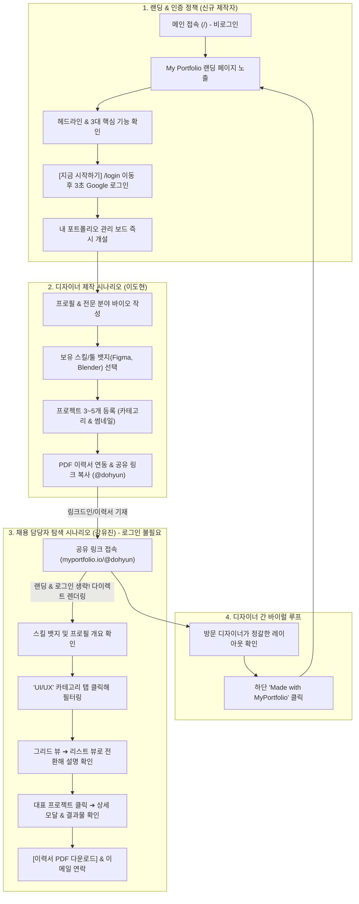

# [PRD] 마이포폴 (MyPortfolio) 제품 요구사항 정의서
## — 디자이너를 위한 올인원 포트폴리오 아카이빙 서비스 —

> **문서 버전:** v2.1.0 (서비스 명칭 개편: 마이링크 ➔ 마이포폴(MyPortfolio), 딥 네이비 80% & 선셋 오렌지 20% 오픈 캔버스 디자인 시스템 정립)  
> **최종 수정일:** 2026-11-15  
> **상태:** 기획 확정 (Approved for Development)  
> **프로젝트:** MyPortfolio (Next.js 16 + Tailwind CSS + Syne & Pretendard 기반 디자이너 포트폴리오 서비스)  

---

## 1. 프로젝트 개요 (Overview)

### 1.1 서비스 소개
**마이포폴 (MyPortfolio)**은 모든 분야(UI/UX, 그래픽, 브랜딩, 3D, 제품, 일러스트 등)의 디자이너들이 자신의 작업물과 커리어를 가장 세련되고 간결하게 아카이빙하고 공유할 수 있는 **디자이너 특화 올인원 포트폴리오 아카이빙 및 멀티 링크 서비스**입니다.  
무겁고 관리가 어려운 개인 웹사이트 구축이나 파편화된 외부 링크(Figma, Behance, Dribbble, Notion, LinkedIn)의 한계를 극복하고, 채용 담당자와 클라이언트에게 최적화된 단일 모바일 반응형 페이지(`myportfolio.io/@designer`)를 제공합니다.

### 1.2 핵심 가치 제안 (Value Proposition)
1. **3분 완성 초간편 아카이빙:** 개발 지식 없이도 프로젝트 썸네일, 설명, 사용 툴(#Figma, #Blender)을 등록하여 감각적인 포트폴리오 페이지 구축.
2. **다채로운 뷰 모드 & 필터링:** 방문자 취향에 따라 **그리드 뷰 ↔ 리스트 뷰 전환 토글** 및 **카테고리 필터(UI/UX, Branding 등)** 제공.
3. **하이브리드 프로젝트 뷰어:** 페이지 내에서 **상세 팝업 모달(작업 배경, 기여도, 이미지)** 확인 후, 필요 시 외부 원본(Figma 프로토타입, Behance)으로 즉시 연결.
4. **원클릭 이력서 다운로드 & 협업 연결:** PDF 포트폴리오/이력서 다운로드 및 직관적인 연락 채널 제공.
5. **MyPortfolio 디자인 시스템 (80% 딥 네이비 & 20% 선셋 오렌지 오픈 캔버스):** 카드 박스(Box) 형태의 제약을 벗어나 순수 화이트 캔버스 위에 딥 네이비(`#0A192F`)의 묵직한 신뢰감과 선셋 오렌지(`#FF5A36`)의 감각적인 포인트를 결합하여 작업물이 가장 돋보이도록 설계.

---

## 2. 타겟 사용자 및 사용자 시나리오 (Target & User Scenarios)

### 2.1 핵심 타겟 페르소나
- **Primary (크리에이터/제작자):**  
  - **이도현 (28세, 4년차 프로덕트/그래픽 디자이너)**
  - **상황:** 이직 준비 및 프리랜서 외주 프로젝트를 위해 포트폴리오를 정리해야 하나, 노션은 모바일 뷰가 투박하고 개인 포트폴리오 웹사이트를 직접 코딩하기엔 시간이 부족함. 비핸스, 피그마 링크, PDF 이력서가 제각각 흩어져 있음.
- **Secondary (방문자/소비자):**  
  - **강유진 (34세, IT 스타트업 디자인 리드 & 채용 담당자)**
  - **상황:** 수많은 디자이너의 지원서를 검토할 때, 모바일/웹에서 빠르고 보기 쉽게 정리된 프로젝트 썸네일과 실제 프로토타입 링크, PDF 이력서를 1분 이내에 훑어보고 싶음.

---

### 2.2 사용자 시나리오 (User Scenarios)

---

## 3. 핵심 디자인 & 시스템 규격 (System Specification)

### 3.1 브랜드 아이덴티티
- **서비스 공식 명칭:** 마이포폴 (MyPortfolio)
- **도메인 / 식별자:** `myportfolio.io/@{username}`

### 3.2 컬러 시스템 (80:20 배색 원칙)
- **Base (80%):** 딥 네이비 (`#0A192F` / `#1E293B`) — 메인 타이틀, 헤더, 묵직한 CTA
- **Accent (20%):** 선셋 오렌지 (`#FF5A36`, Hover: `#E84E2B`, Weak: `#FFF2EE`) — 하단 전환 CTA, 로고 심볼 화살표, 텍스트 하이라이트
- **Canvas:** 순백색 화이트 (`#FFFFFF`) — 갇힌 카드 박스 스타일 배제
- **Neutral Surface:** 뉴트럴 슬레이트 (`#F1F5F9`, `#E2E8F0`, `#CBD5E1`)

### 3.3 타이포그래피 계층
- **Brand & Display Hero:** `Syne` (ExtraBold 800) — 현대적이고 유니크한 기하학적 형태감
- **Korean Headline & Body:** `Pretendard` (Black 900, Bold 700, SemiBold 600, Regular 400)

---

## 4. 핵심 기능 목록 (Core Features)

1. **3분 초간편 아카이빙:**
   - 프로젝트 썸네일, 설명, 사용 툴(#Figma, #Blender 등) 태그 등록
2. **그리드 & 리스트 듀얼 뷰:**
   - 방문자 선호에 맞춘 썸네일 중심 그리드 뷰 ↔ 상세 설명 중심 리스트 뷰 실시간 전환
3. **원스톱 뷰어 & 원클릭 이력서 연동:**
   - 페이지 이탈 없는 프로젝트 상세 모달 확인
   - 외부 Figma 프로토타입 원본 및 PDF 이력서 다운로드 다이렉트 연결
