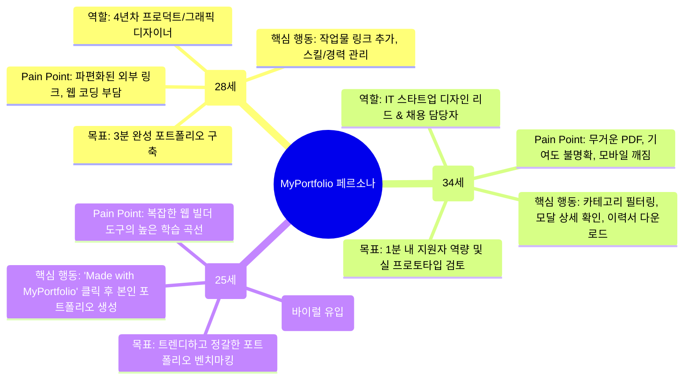
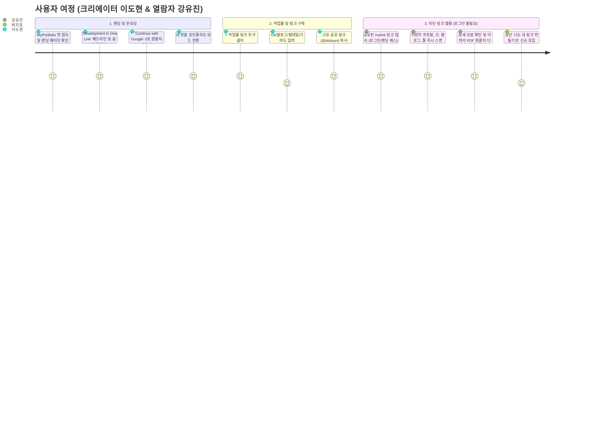

# [사용자 시나리오 정의서] 마이포폴 (MyPortfolio)
## — 디자이너를 위한 올인원 포트폴리오 아카이빙 서비스 —

> **문서 버전:** v1.0.0  
> **관련 문서:** `PRD_mylink.md`, `design.md`  
> **작성일:** 2026-11-06  
> **상태:** 기획 및 기능 구현 반영 완료 (Approved)  
> **프로젝트:** MyPortfolio (Next.js 16 + Tailwind CSS + shadcn/ui + Notion 스타일 기반 디자이너 포트폴리오 허브)

---

## 1. 개요 및 목적 (Overview & Purpose)

본 문서는 **마이포폴(MyPortfolio)** 서비스의 주요 타겟 사용자가 서비스를 탐색, 구축, 공유, 검토하는 전체 사용자 경험(UX) 흐름을 구체적인 시나리오로 정의합니다.  
디자이너 사용자가 자신의 작업물과 역량을 3분 만에 모바일 최적화된 올인원 페이지로 정리하는 과정과, 채용 담당자/클라이언트가 1분 이내에 핵심 역량을 파악하고 실제 프로토타입을 확인한 뒤 연락을 취하는 전 과정을 다룹니다.

---

## 2. 사용자 페르소나 (User Personas)

### 2.1 Primary Persona: 이도현 (28세, 4년차 프로덕트 & 시각 디자이너)
* **특징:** 스타트업에서 UI/UX와 브랜딩을 두루 담당. 이직 준비와 외주 프로젝트 수주를 위해 포트폴리오를 지속적으로 업데이트해야 함.
* **불편 사항(Pain Points):**
  * Figma, Behance, Notion, GitHub, Dribbble 등 작업물이 제각각 분산되어 있어 채용 담당자에게 전달하기 번거로움.
  * 개인 웹사이트를 직접 코딩하거나 웹플로우/노션을 쓰면 모바일 반응형 뷰가 투박하고 유지 관리가 어려움.
  * 새로운 사이드 프로젝트나 수상 이력을 수시로 빠르게 추가하고 싶음.
* **주요 목표(Goals):**
  * 3분 만에 모바일/데스크톱 모두에서 세련된 단일 링크(`mylink.io/@dohyun`)를 완성.
  * 작업물별 기여도와 실제 피그마 프로토타입을 깔끔하게 보여주고, 최신 PDF 이력서를 연결.

### 2.2 Secondary Persona: 강유진 (34세, IT 스타트업 디자인 리드 & 채용 담당자)
* **특징:** 매주 수십 건의 디자이너 입사 지원서와 포트폴리오를 검토. 출퇴근길 모바일에서도 지원서를 자주 확인.
* **불편 사항(Pain Points):**
  * 대용량 PDF 파일은 모바일에서 로딩이 느리고 텍스트/이미지 확인이 불편함.
  * 팀 프로젝트에서 지원자가 실제로 어느 파트를 담당했는지 기여도를 한눈에 알기 어려움.
  * 정적인 캡처 이미지만으로는 실제 마이크로 인터랙션이나 완성도를 검증하기 힘듦.
* **주요 목표(Goals):**
  * 지원자의 전문 분야, 사용 도구 숙련도, 대표 프로젝트를 1분 내에 스캔.
  * 팀/개인 프로젝트 구분과 기여도를 명확히 파악하고, 외부 Figma 프로토타입으로 즉시 확인.
  * 만족스러울 경우 즉시 이력서 PDF를 다운로드하고 이메일로 면접/커피챗 제안.

### 2.3 Tertiary Persona: 박지호 (25세, 주니어 디자이너)
* **특징:** 감각적인 디자인 포트폴리오 레퍼런스를 수집하는 주니어 디자이너.
* **주요 목표(Goals):**
  * 동료 디자이너의 프로필 하단 `Made with MyPortfolio` 배너를 발견하고 즉시 유입되어 자신만의 무료 포트폴리오 링크를 개설.

---

## 3. 엔드투엔드 유저 저니 맵 (User Journey Map)

---

## 4. 세부 사용자 시나리오 (Detailed User Scenarios)

### 시나리오 1: [신규 온보딩] 미니멀 랜딩 페이지 경험 및 첫 페이지 개설
* **주인공:** 이도현 (개발자 겸 디자이너)
* **목표:** MyPortfolio에 처음 방문하여 헤더와 군더더기 없는 미니멀 랜딩을 확인하고, Google 로그인 후 나만의 링크 페이지를 시작한다.
* **진행 흐름:**
  1. **초기 랜딩 페이지 진입:** 도현은 MyPortfolio 메인 도메인에 접속한다. 로그인을 하지 않은 상태이므로 초기 랜딩 페이지가 표시된다.
  2. **극도의 미니멀 인터페이스:**
     * 헤더, 복잡한 기능 카드, 샘플 링크가 일체 배제된 채, 중앙에 `My Portfolio` 타이틀과 `Development in One Link. Showcase your git, blog, and more.` 헤드라인만 정갈하게 떠 있다.
  3. **Google 로그인:** 중앙의 단정한 `[ G Continue with Google ]` 버튼을 클릭한다.
  4. **본인 보드로 즉시 전환 & 클린 슬레이트 시작:**
     * 구글 인증이 완료되자마자 개인화된 포트폴리오 관리 보드(`/`)로 전환된다.
     * **최초 로그인 시 다른 사람의 더미 정보(Figma 95%, Toss 등)가 일체 없이 깨끗한 빈 상태로 시작**하여, 도현 본인의 작업물과 숙련도만 온전히 담을 수 있다.
  5. **우측 상단 아바타 메뉴 활용:**
     * 헤더 우측 상단에 위치한 자신의 프로필 아바타를 클릭하자 드롭다운 메뉴가 열린다.
     * `[프로필 편집]`을 눌러 직함과 바이오를 작성하고, `[내 링크 복사]`를 눌러 지인들에게 공유할 `/@dohyun` 링크를 바로 클립보드에 복사한다.

---

### 시나리오 2: [타인 링크 열람] 채용 담당자의 로그인 없는 다이렉트 조회
* **주인공:** 강유진 (IT 스타트업 채용 담당자)
* **목표:** 지원자가 이력서에 기재한 MyPortfolio URL(`mylink.io/@dohyun`)을 통해 지원자의 역량을 1분 만에 파악한다.
* **진행 흐름:**
  1. **다이렉트 접속 (로그인 & 랜딩 생략):** 유진은 지원자가 공유한 링크를 클릭한다. **로그인을 요구하거나 초기 랜딩 페이지가 뜨지 않고, 도현의 포트폴리오 화면이 즉시 렌더링된다.**
  2. **핵심 역량 스캔:** 상단의 GitHub, 기술 블로그, Behance 링크와 함께 툴 숙련도(React, Figma)와 경력 타임라인을 10초 만에 훑어본다.
  3. **프로젝트 상세 및 프로토타입 확인:** 대표 프로젝트 카드를 클릭하여 기여도(기획 50%, 디자인 80%, 프론트엔드 100%)와 실제 외부 결과물 링크를 확인한다.
  4. **이력서 다운로드 및 연락:** 상단의 `[이력서 PDF 다운로드]` 버튼을 눌러 공식 이력서를 받고, 이메일 아이콘을 눌러 면접을 제안한다.
  5. **바이럴 확장:** 상단 우측에 있는 `[나도 내 링크 만들기]` 버튼을 확인하고, 유진 자신도 링크를 만들어보기 위해 북마크에 추가한다.

---

### 시나리오 3: [프로필 설정] 디자이너의 프로필 및 소셜 채널 등록
* **진행 흐름:**
  1. **추가 다이얼로그 호출:** 메인 페이지 상단의 `[+ 작업물 링크 추가]` 플로팅 버튼을 클릭하여 `AddLinkModal`을 연다.
  2. **기본 메타데이터 작성:**
     * 프로젝트 제목: "Toss 결제 경험 리뉴얼 프로젝트" (필수)
     * 한 줄 소개: "복잡한 결제 플로우를 3단계로 간소화하여 전환율 18%를 개선한 UI/UX 프로젝트" (필수)
  3. **카테고리 및 프로젝트 성격 설정:**
     * 기존 카테고리 중 `UI/UX`를 선택한다. 만약 새로운 분야라면 직접 카테고리를 입력하여 추가할 수도 있다.
     * 작업 구분 세그먼트 토글에서 `[팀 프로젝트]`를 선택한다.
  4. **대표 썸네일 등록:**
     * 로컬 기기에서 디자인 목업 이미지 파일을 드래그앤드롭으로 첨부한다.
     * 파일 첨부 시 자동으로 압축되어 미리보기 카드에 실시간 표시된다. (추천 프리셋 5종 중 선택도 가능)
  5. **사용 도구(Tools) 태그 선택:**
     * "Figma", "Protopie"를 입력하여 태그로 등록한다. 이전에 썼던 태그가 추천 칩으로 나타나 원클릭으로 선택한다.
  6. **외부 인터랙티브 링크 연동:**
     * 외부 링크 라벨: "Figma Prototype 확인"
     * 대상 URL: `figma.com/proto/...` 입력 시 `https://` 누락을 자동 보정하며 유효성 검사를 통과한다.
  7. **상세 정보 아코디언 확장 (선택):**
     * 작업 기간: "2026.03 ~ 2026.05"
     * 기여도: "Product Design Lead (기여도 80%)"
     * 상세 케이스 스터디 본문 작성
  8. **발행:** `[등록하기]` 버튼을 누른다. 데이터는 Firestore(`users/anonymous/links`)와 `localStorage`에 즉시 반영되며, 메인 쇼케이스 최상단에 새 프로젝트 카드가 나타난다.

---

### 시나리오 3: [채용 담당자 탐색] 원스톱 프로젝트 검토 및 채용 제안
* **주인공:** 강유진 (IT 스타트업 채용 담당자 / 디자인 리드)
* **목표:** 지원자의 포트폴리오를 1분 이내에 훑어보고, 직무 적합성을 판단하여 면접을 제안한다.
* **진행 흐름:**
  1. **링크 접속:** 지원서에 첨부된 `mylink.io/@dohyun` 링크를 스마트폰으로 터치한다. 1초 미만의 빠른 로딩으로 화면이 열린다.
  2. **5초 스캔:** 상단 프로필 헤더에서 직함("Product & Visual Designer")과 4년차 경력을 확인하고, 바로 아래 위치한 **도구 숙련도 바(Tool Proficiency Bars)**를 통해 Figma 95%, Protopie 85%의 숙련도를 직관적으로 확인한다.
  3. **카테고리 필터링:** 현재 채용 중인 직무인 `[UI/UX]` 탭을 누른다. 브랜딩/그래픽 작업물은 사라지고 UI/UX 관련 3개 프로젝트만 즉시 필터링된다.
  4. **뷰 모드 전환:** 상단 뷰 모드 토글을 `[그리드 뷰 ⊞]`에서 `[리스트 뷰 ☰]`로 전환하여 각 프로젝트의 요약 설명과 사용 도구, 팀 프로젝트 뱃지를 한눈에 확인한다.
  5. **하이브리드 프로젝트 상세 모달 열기:** 대표 프로젝트 카드를 터치한다.
     * 별도 페이지 이동 없이 **스크롤바 없는 미니멀 다이얼로그(`ProjectDetailModal`)**가 부드럽게 팝업된다.
     * 상단의 파란색 **읽기 진행률 라인(Reading Progress Bar)**과 하단 그라디언트 페이드 안내 힌트를 보며 자연스럽게 스크롤을 내린다.
     * 프로젝트 개요, 본인이 기여한 80% 역할, 고해상도 디자인 결과물을 확인한다.
  6. **Figma 프로토타입 검증:** 모달 하단에 고정된 `[Figma Prototype 확인 ↗]` 버튼을 눌러 새 탭에서 실제 인터랙션을 테스트하고 깊은 인상을 받는다.
  7. **이력서 다운로드 및 연락:** 모달을 닫고 상단 프로필 헤더의 `[📄 Resume / 이력서 다운로드]` 버튼을 눌러 PDF 이력서를 사내 슬랙 채널로 공유한 뒤, 소셜 바의 `[이메일 아이콘]`을 눌러 바로 면접 제안 메일을 발송한다.

---

### 시나리오 4: [유지 관리] 프로젝트 인라인 수정 및 안전한 데이터 삭제
* **주인공:** 이도현 (디자이너)
* **목표:** 프로젝트 상세 페이지에서 내용을 수정하고, 이전 만료된 프로젝트를 안전하게 정리한다.
* **진행 흐름:**
  1. **개별 프로젝트 페이지 진입:** 특정 프로젝트 카드를 클릭하여 전용 URL인 `/projects/[id]`로 이동한다.
  2. **인라인 편집 모드 전환:** 상단 우측의 `[수정]` 버튼을 클릭하면 `ProjectInlineEditCard` 컴포넌트가 활성화되며 제목, 한 줄 설명, 기여도 입력창이 제자리에서 편집 가능한 폼으로 전환된다.
  3. **내용 갱신:** 최근 업데이트된 성과 지표를 추가하고 `[저장]`을 누른다. Firestore와 로컬스토리지에 즉시 동기화된다.
  4. **프로젝트 삭제 시도:** 더 이상 노출을 원치 않는 구 프로젝트의 `[삭제]` 아이콘을 누른다.
  5. **통합 삭제 확인 모달(`DeleteConfirmModal`):**
     * 실수를 방지하기 위해 "해당 작업물을 정말 삭제하시겠습니까? 삭제된 데이터는 복구할 수 없습니다." 경고 모달이 팝업된다.
     * `[삭제하기]`를 확정하면 로딩 스피너와 함께 안전하게 제거된 후 메인 목록으로 이동한다.
  6. **도구 및 경력 인라인 관리:** 메인 화면의 `ToolProficiencyBars`와 `CareerTimeline`에서도 각각 수정/삭제 버튼을 눌러 숙련도 수치와 이력을 즉시 편집한다.

---

### 시나리오 5: [바이럴 유입] 방문 디자이너의 신규 개설
* **주인공:** 박지호 (신입 UI/UX 디자이너)
* **목표:** 동료의 MyPortfolio 페이지를 감상하다가 자신만의 포트폴리오를 제작한다.
* **진행 흐름:**
  1. 도현의 포트폴리오를 끝까지 둘러본 지호는 하단 푸터의 **"Made with MyPortfolio"** 브랜딩 배너를 발견한다.
  2. 클릭 시 MyPortfolio 서비스 소개 및 템플릿 안내 페이지로 이동한다.
  3. 별도의 복잡한 설치 없이 자신만의 핸들을 생성하고 포트폴리오를 제작하기 시작한다.

---

## 5. 예외 상황 및 엣지 케이스 시나리오 (Edge Cases & Fallback)

| 구분 | 예외 상황 | 사용자 경험(UX) 및 시스템 처리 |
|---|---|---|
| **네트워크 단절 / 오프라인** | Firebase Firestore 통신 실패 시 | `localStorage`에 저장된 캐시 데이터를 우선 표출하고, 상단에 부드러운 오프라인 안내 토스트 표시 |
| **대용량 이미지 첨부** | 사용자가 10MB 이상의 고해상도 PNG/JPG 첨부 | `imageUtils.ts`의 `compressImageFile`을 통해 브라우저 상에서 가로폭 1200px 및 80% WebP/JPEG 품질로 자동 압축 후 저장 |
| **잘못된 URL 입력** | 프로토콜(`http://`, `https://`) 누락 또는 형식 오류 | 포커스 아웃 시 자동으로 `https://` 접두사를 보정하며, 도메인 형식이 올바르지 않을 경우 인라인 붉은 에러 문구 표시 |
| **필수값 미입력** | 프로젝트 제목 또는 한 줄 요약 없이 등록 시도 | 등록 버튼 클릭 시 미입력 필드로 자동 스크롤/포커싱되며 Shake 애니메이션 및 붉은색 보더 피드백 제공 |
| **검색 결과 없음** | 검색창에 일치하는 프로젝트명이 없을 때 | "일치하는 프로젝트가 없습니다. 다른 검색어를 입력해보세요." 빈 화면(Empty State) 일러스트와 필터 초기화 버튼 노출 |
| **미등록 카테고리** | 디자이너가 완전히 새로운 분야(예: 사운드 디자인) 등록 | `+ 직접 입력` 옵션을 통해 신규 카테고리를 동적으로 등록하고, 상단 카테고리 필터 탭에 즉시 영구 반영 |
