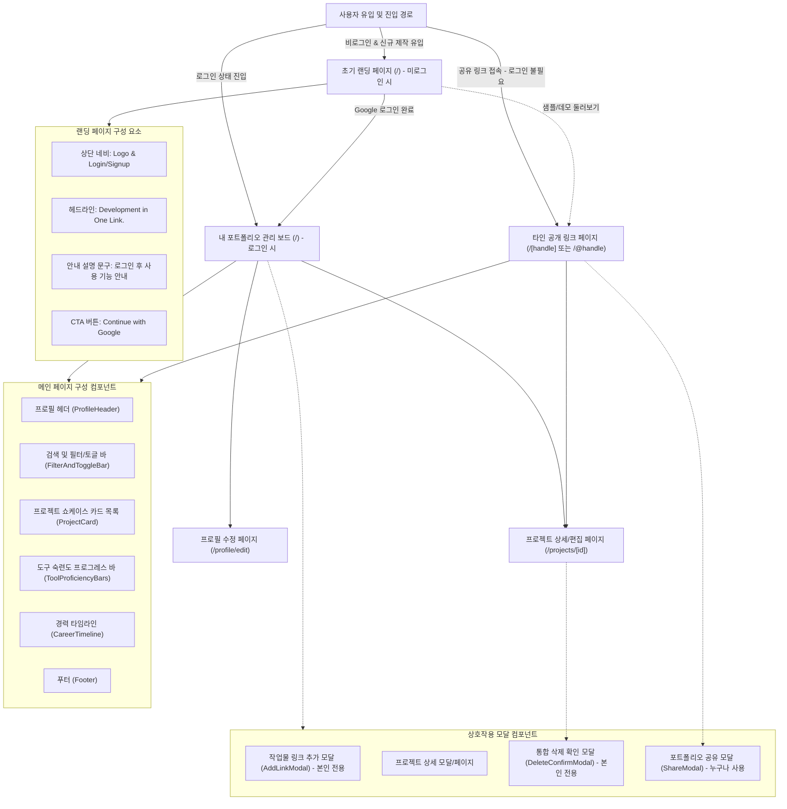
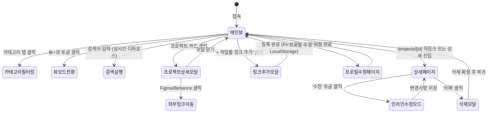

# [와이어프레임 및 화면 설계서] 마이링크 (MyLink)
## — 디자이너를 위한 올인원 포트폴리오 아카이빙 서비스 —

> **문서 버전:** v1.0.0  
> **관련 문서:** `PRD_mylink.md`, `design.md`, `user_scenario.md`  
> **작성일:** 2026-11-06  
> **상태:** 화면 설계 및 컴포넌트 명세 확정 (Approved)  
> **프로젝트:** MyLink (Next.js 16 + Tailwind CSS + shadcn/ui + TDS 스타일 기반 디자이너 포트폴리오 허브)

---

## 1. 레이아웃 시스템 및 규격 (Layout System & Specs)

### 1.1 뷰포트 규격 및 실시간 리사이징 시스템
* **상단 뷰포트 제어 바 (`DeviceViewportBar`):**
  * **모바일 버전 (390px):** 스마트폰 디바이스 프레임(`rounded-3xl border shadow-2xl`), 2열 컴팩트 카드 그리드, 세로 1열 스택 섹션, 가로 스크롤 및 자동 신축 레이아웃으로 토글 버튼 오버플로우 원천 차단
  * **태블릿 버전 (680px):** 태블릿 규격 뷰(`rounded-2xl border shadow-xl`), 최적 가독성의 2열 프로젝트 그리드
  * **웹/데스크톱 버전 (680px 고정 태블릿 프레임):** 웹 화면 전체를 무리하게 채워 정보가 분산되는 문제를 해결하기 위해, 회색 배경 프레임(`bg-[#F3F4F6]`) 중앙에 680px 고정 태블릿 카드 형태로 단정하고 컴팩트하게 배치 (Linear / Notion 스타일의 담백한 포커스 뷰)
  * **창 크기 자동 맞춤 (반응형):** 브라우저 창 가로폭에 유연하게 대응하되 중앙 680px 포커스 프레임 유지
  * **가로폭 미세 조정 슬라이더 (360px ~ 960px):** 실시간 픽셀 단위 자유 리사이징 슬라이더 지원
  * **전체 페이지 적용:** 메인 페이지(`/`, `/[handle]`), 프로필 수정 페이지(`/profile/edit`), 프로젝트 상세 페이지(`/projects/[id]`)에 동일한 뷰포트 제어 시스템 탑재
* **Auto Layout & 반응형 오버플로우 방지:**
  * **모바일 배치 토글 오버플로우 방지:** 검색창 인풋을 `flex-1 min-w-0`으로 설정하고 우측 뷰 토글 박스를 `shrink-0`으로 고정하여 390px 모바일 화면에서도 요소가 프레임 밖으로 튀어나가지 않음
  * **카드 뱃지 오버플로우 방지:** 모바일 2열(160px 대)에서도 카테고리 뱃지와 개인/팀 뱃지가 겹치지 않도록 `absolute top-2 inset-x-2 flex justify-between` 및 `truncate max-w-[58%]` 적용
  * **카테고리 필터 탭 가로 스크롤:** `min-w-0 flex-1`을 적용하여 모바일 스크롤 시 우측 검색/토글 버튼이 밀려나지 않도록 격리
  * **텍스트 줄바꿈 및 말줄임:** 긴 제목 및 링크에 `truncate` 및 `break-words` 적용으로 카드 영역 이탈 방지

### 1.2 미니멀 디자인 시스템 (Linear / Notion 스타일)
* **Primary Brand / Neutrals:** 모던 모노크롬 `#191F28` (Charcoal Black), `#333D4B` (Dark Slate), `#E5E8EB` (Line Grey)
* **Background Canvas:** 회색 프레임 캔버스 `#F3F4F6` 및 카드 화이트 `#FFFFFF`
* **Card Surface:** `#FFFFFF` (`border border-[#E5E8EB] shadow-2xs rounded-2xl`)
* **Typography:**
  * Title: `Pretendard Bold 20px~24px` (`text-[#191F28]`)
  * Body: `Pretendard Medium/Regular 14px~15px` (`text-[#333D4B]` / `text-[#4E5968]`)
  * Caption/Badge: `Pretendard SemiBold 11px~12px` (`text-[#8B95A1]`)
* **Radius:** 기본 컨테이너 `rounded-2xl` (16px), 버튼/인풋 `rounded-xl` (12px), 뱃지 `rounded-full` / `rounded-md`
* **디자인 원칙:** 과도한 형광 블루, 인위적인 AI 스파클/무지개 그라데이션을 철저히 배제하고 사람이 정갈하게 가꾼 Notion / Linear 감성의 담백한 미니멀리즘 유지

---

## 2. 정보 구조도 (Information Architecture & Site Map)



---

## 3. 화면별 상세 와이어프레임 (Screen Wireframes)

### 3.0 [화면 0] 초기 랜딩 페이지 (`/` 비로그인 사용자)
> **목적:** 자신의 페이지를 만들고자 처음 유입된 비로그인 사용자에게 직관적이고 군더더기 없는 미니멀 화면을 제공하여 3초 만에 구글 계정으로 시작하도록 유도합니다. **헤더, 부가 설명, 샘플 링크를 일체 배제한 극도의 심플함을 지향합니다.**

#### [와이어프레임 구조도 - 중앙 집중 미니멀 레이아웃]

```text
+----------------------------------------------------+
|                                                    |
|                                                    |
|                      MY LINK                       | <-- 브랜드 타이틀
|                                                    |
|              Development in One Link.              | <-- 헤드라인 메인
|         Showcase your git, blog, and more.         | <-- 헤드라인 서브
|                                                    |
|            +----------------------------+          |
|            | G  Continue with Google    |          | <-- CTA 버튼
|            +----------------------------+          |
|                                                    |
|                                                    |
|                      © My Link                     | <-- 심플 푸터
+----------------------------------------------------+
```

* **주요 요소 명세:**
  * **헤더 완전 삭제:** 상단 네비게이션 바(로고, 로그인/가입 버튼 등)를 두지 않고 중앙 컨텐츠에만 시선 집중.
  * **부가 설명 및 샘플 링크 삭제:** 복잡한 기능 카드, 안내 박스, 데모 링크를 배제하여 인위적인 느낌 제거.
  * **헤드라인 (Headline):**
    * 메인 카피: `Development in One Link.`
    * 서브 카피: `Showcase your git, blog, and more.`
  * **CTA 버튼:**
    * `[ G Continue with Google ]` 단일 원클릭 소셜 로그인 버튼.
    * 로그인 완료 시 즉시 본인의 개인화된 포트폴리오 관리 보드(`/`)로 전환.

---

### 3.1 [화면 1-A] 내 포트폴리오 관리 화면 (`/` 로그인 사용자)

#### [와이어프레임 구조도 - 모바일/웹 공통 컨테이너 `max-w-2xl`]

```text
┌────────────────────────────────────────────────────────┐
│  [Top Navigation Bar]                                  │
│  My Link                                       (Avatar)│ <-- 아바타 클릭 시 드롭다운
│                                                ┌───────┴──────────────┐
│                                                │ 이도현               │
│                                                │ @dohyun              │
│                                                ├──────────────────────┤
│                                                │ 👤 프로필 편집       │
│                                                │ 🔗 내 링크 복사      │
│                                                ├──────────────────────┤
│                                                │ 🚪 로그아웃          │
│                                                └──────────────────────┘
│  [ProfileHeader]                                       │
│                    ┌──────────┐                        │
│                    │  Avatar  │ (원형 프로필 사진)     │
│                    └──────────┘                        │
│                     이도현  @dohyun                    │
│             Product & Visual Designer                  │
│   "사용자 경험을 고민하고 문제를 시각적으로 해결합니다."    │
│                                                        │
│     (Gh) (In) (Be) (Dr) (Ig) (✉️) (공식 소셜 아이콘 바)  │
│                                                        │
│   [ 📄 이력서 다운로드 ↗ ] (등록된 이력서가 있을 때만 노출)  │
│                                                        │
├────────────────────────────────────────────────────────┤
│  [FilterAndToggleBar]                                  │
│  [ All ] [ UI/UX ] [ Web ] [ 3D ]         [ ⊞ 카드 | ☰ 목록 ]
├────────────────────────────────────────────────────────┤
│  [Search Bar]                                          │
│  🔍 프로젝트명, 기술 스택 검색                          │
├────────────────────────────────────────────────────────┤
│  [Project Showcase - 작업물 목록]         [+ 링크 추가]│
│  (작업물 카드 목록 - 그리드 2열 또는 리스트 1열)        │
├────────────────────────────────────────────────────────┤
│  [ToolProficiencyBars - 도구 숙련도]      [+ 도구 추가]│
│  (최초 로그인 시 더미 데이터 없이 빈 상태로 제공)      │
├────────────────────────────────────────────────────────┤
│  [CareerTimeline - 경력 및 활동]          [+ 경력 추가]│
│  (최초 로그인 시 더미 데이터 없이 빈 상태로 제공)      │
├────────────────────────────────────────────────────────┤
│  [Footer]                                              │
│  My Link  •  Development in One Link                   │
└────────────────────────────────────────────────────────┘
```

* **핵심 변경 명세:**
  * **상단 헤더 좌측:** 오직 `My Link` 텍스트 명칭만 단정하게 유지 (뱃지, 태그 일체 제거).
  * **상단 헤더 우측:** 기존 공유/수정/로그아웃 개별 버튼을 모두 삭제하고, **프로필 아바타 버튼 단독 배치**.
    * 아바타 클릭 시 토글되는 드롭다운:
      1. 사용자 이름 및 핸들 정보
      2. **프로필 편집** (`/profile/edit` 이동)
      3. **내 링크 복사** (클립보드에 `/@handle` 링크 복사 + 토스트 알림)
      4. **로그아웃**
  * **프로필 헤더 우측 중복 버튼 제거:** 기존 헤더 우측 상단에 중복 배치되어 있던 수정/공유 버튼을 삭제하여 상단바 드롭다운으로 일원화.
  * **이력서 버튼 조건부 노출:** 사용자가 이력서 PDF를 등록하지 않은 경우 이력서 버튼이 화면에 전혀 나타나지 않음.
  * **최초 로그인 시 더미 데이터 격리:** 신규 로그인 유저의 숙련도/경력에 샘플 데이터(Figma 95%, Toss 등)를 주입하지 않고 깨끗한 빈 상태(`[]`)로 시작.

#### [리스트 뷰 전환 시 프로젝트 카드 레이아웃 (1열 와이드 카드)]
```text
┌────────────────────────────────────────────────────────┐
│ ┌──────────────┐  Toss 결제 경험 리뉴얼 [팀 프로젝트]    │
│ │              │  UI/UX Design • 2026.03 ~ 2026.05     │
│ │  Thumbnail   │  복잡한 결제 플로우를 3단계로 간소화    │
│ │   (16 : 9)   │  하여 전환율 18% 개선                  │
│ │              │  [Figma] [ProtoPie]                   │
│ └──────────────┘  [Figma 프로토타입 ↗]  [상세보기 >]   │
└────────────────────────────────────────────────────────┘
```

---

### 3.1-B [화면 1-B] 타인 공개 링크 열람 화면 (`/[handle]`, `/@handle`, `/?u=handle`)
> **목적:** 채용 담당자, 동료, 클라이언트 등 외부 방문자가 로그인 없이도 대상 사용자의 포트폴리오와 모든 링크를 즉시 열람할 수 있는 화면입니다. **초기 랜딩 페이지가 표시되지 않고 다이렉트로 접속됩니다.**

#### [와이어프레임 구조도 - 비로그인 방문자 열람 모드]

```text
┌────────────────────────────────────────────────────────┐
│  [Top Navigation]                                      │
│  [Logo] MyLink      [홍길동 님의 링크]   [공유] [나도 내 링크 만들기] │
│                                                        │
│  [ProfileHeader (읽기 전용)]                           │
│                    ┌──────────┐                        │
│                    │  Avatar  │                        │
│                    └──────────┘                        │
│                     홍길동                             │
│             Frontend & Product Designer                │
│   "사용자 중심 인터랙션을 만들고 코드로 구현합니다."     │
│                                                        │
│     (Be) (In) (Gh) (Dr) (✉️) (외부 소셜 및 깃/블로그)   │
│        [ 📄 Resume / 이력서 PDF 다운로드 ↗ ]          │
├────────────────────────────────────────────────────────┤
│  [FilterAndToggleBar]                                  │
│  [All (6)] [UI/UX (3)] [Web (2)] [3D (1)]    [⊞] [☰]  │
├────────────────────────────────────────────────────────┤
│  [Search Bar]                                          │
│  🔍 프로젝트명, 기술 스택 검색                          │
├────────────────────────────────────────────────────────┤
│  [ProjectCard 목록 (방문자 열람 모드)]                 │
│  (클릭 시 외부 깃/프로토타입 이동 및 상세 모달 확인 가능)│
├────────────────────────────────────────────────────────┤
│  [ToolProficiencyBars (읽기 전용 프로그레스 바)]       │
│  [CareerTimeline (읽기 전용 활동 이력)]                │
├────────────────────────────────────────────────────────┤
│  [Footer]                                              │
│  Made with MyLink  •  Development in One Link          │
└────────────────────────────────────────────────────────┘
```

* **핵심 정책 및 기능:**
  * **로그인 생략 (Zero-Gate):** 로그인 화면이나 랜딩 페이지가 전혀 나타나지 않고, 해당 사용자의 프로필과 링크가 즉시 렌더링됩니다.
  * **읽기 전용 모드 (Read-Only):** 작업물 추가(`+ 링크 추가`), 프로필 수정, 도구/경력 삭제 등 편집성 UI는 숨겨지며, 외부 링크 아웃링크, 모달 상세 확인, 이력서 다운로드, 공유하기 기능만 제공됩니다.
  * **바이럴 유입 CTA:** 상단 우측에 `[나도 내 링크 만들기]` 버튼이 배치되어, 포트폴리오를 감상한 방문자가 언제든 원클릭으로 구글 로그인 후 자신만의 페이지를 개설할 수 있습니다.

---

### 3.2 [화면 2] 작업물 링크 추가 다이얼로그 (`AddLinkModal`)

```text
┌────────────────────────────────────────────────────────┐
│  새 작업물 링크 추가                                 [X] │
│  포트폴리오에 등록할 프로젝트 정보와 외부 링크를 입력하세요│
├────────────────────────────────────────────────────────┤
│  카테고리 선택 *                                       │
│  [ UI/UX ] [ 브랜딩 ] [ 그래픽 ] [ 3D/모션 ] [+ 직접추가]│
│                                                        │
│  작업 구분 *                                           │
│  ┌───────────────────────┬───────────────────────────┐ │
│  │      👤 개인 작업      │      👥 팀 프로젝트       │ │
│  └───────────────────────┴───────────────────────────┘ │
│                                                        │
│  프로젝트 제목 *                                       │
│  ┌───────────────────────────────────────────────────┐ │
│  │ 예: 토스 페이 결제 화면 사용성 개선 프로젝트      │ │
│  └───────────────────────────────────────────────────┘ │
│                                                        │
│  한 줄 요약 *                                          │
│  ┌───────────────────────────────────────────────────┐ │
│  │ 핵심 성과 및 디자인 의도를 1~2줄로 요약해주세요   │ │
│  └───────────────────────────────────────────────────┘ │
│                                                        │
│  대표 썸네일 이미지                                    │
│  ┌─────────────────────────┬─────────────────────────┐ │
│  │   📁 로컬 파일 업로드   │     🌐 이미지 URL 입력    │ │
│  └─────────────────────────┴─────────────────────────┘ │
│  ┌ ─ ─ ─ ─ ─ ─ ─ ─ ─ ─ ─ ─ ─ ─ ─ ─ ─ ─ ─ ─ ─ ─ ─ ─ ─ ┐ │
│    클릭하여 이미지 파일 선택 또는 드래그앤드롭           │
│    (JPG, PNG, WebP 최대 10MB - 자동 압축 최적화)        │
│  └ ─ ─ ─ ─ ─ ─ ─ ─ ─ ─ ─ ─ ─ ─ ─ ─ ─ ─ ─ ─ ─ ─ ─ ─ ─ ┘ │
│  추천 프리셋: [금융/핀테크] [이커머스] [브랜딩] [모바일앱]│
│                                                        │
│  사용 도구 (Tools)                                     │
│  ┌──────────────────────────────────────────────[추가]│ │
│  │ 도구명 입력 (예: Figma, Blender, Spline)           │ │
│  └────────────────────────────────────────────────────┘│
│  추천 도구: [+ Figma] [+ ProtoPie] [+ Illustrator]     │
│  선택된 툴: [Figma x] [ProtoPie x]                     │
│                                                        │
│  외부 원본 링크 (Figma / Behance 등)                   │
│  버튼명: [ Figma 프로토타입 확인 ↗                   ] │
│  URL:    [ https://figma.com/proto/...                ] │
│                                                        │
│  ▼ 상세 정보 추가 (작업 기간, 역할, 상세 본문) [확장됨]  │
│  작업 기간: [ 2026.03 ~ 2026.05                     ]  │
│  역할/기여도: [ Product Design Lead (기여도 80%)    ]  │
│  상세 설명:                                            │
│  ┌───────────────────────────────────────────────────┐ │
│  │ 문제 정의, 사용자 리서치 인사이트, 디자인 솔루션을│ │
│  │ 자유롭게 작성할 수 있습니다.                      │ │
│  └───────────────────────────────────────────────────┘ │
├────────────────────────────────────────────────────────┤
│                 [ 취소 ]     [ 등록 완료 ] (Toss Blue) │
└────────────────────────────────────────────────────────┘
```

---

### 3.3 [화면 3] 하이브리드 프로젝트 상세 모달 (`ProjectDetailModal`)

```text
┌────────────────────────────────────────────────────────┐
│ [══════════════════════════════════════░░░] Progress (상단 진행률)
│                                                    [X] │
│  [ UI/UX Design ]  [ 팀 프로젝트 ]                     │
│  Toss 결제 경험 리뉴얼 프로젝트                        │
│  2026.03 ~ 2026.05  •  Product Design Lead (기여도 80%)│
│                                                        │
│  ┌──────────────────────────────────────────────────┐  │
│  │                                                  │  │
│  │           Main High-Res Thumbnail Image          │  │
│  │                                                  │  │
│  └──────────────────────────────────────────────────┘  │
│                                                        │
│  사용 도구                                             │
│  [ Figma ]  [ ProtoPie ]  [ React ]                    │
│                                                        │
│  프로젝트 소개                                         │
│  토스 간편결제 시스템의 사용자 여정을 재설계하여 이탈률 │
│  이 높았던 인증 단계를 1단계로 축소하고, 결제 완료 전  │
│  혜택 안내 인터랙션을 강화하여 사용자 경험을 극대화    │
│  하였습니다.                                           │
│                                                        │
│  주요 성과 및 인사이트                                 │
│  1. 결제 전환율 기존 대비 18.4% 상승                   │
│  2. 결제 완료까지 평균 소요 시간 4.2초 단축            │
│                                                        │
│  ▼ 아래로 스크롤하여 더 보기 (Fade-out 가이드 힌트)   │
├────────────────────────────────────────────────────────┤
│  [고정 바텀 CTA]                                       │
│  ┌──────────────────────────────────────────────────┐  │
│  │       [ Figma 프로토타입 바로가기 ↗ ]             │  │
│  └──────────────────────────────────────────────────┘  │
│   [ 수정하기 ]                       [ 이 프로젝트 삭제 ]│
└────────────────────────────────────────────────────────┘
```

---

### 3.4 [화면 4] 프로젝트 상세 및 인라인 편집 페이지 (`/projects/[id]`)

```text
┌────────────────────────────────────────────────────────┐
│  [< 뒤로가기]                      [ ✏️ 수정 ] [ 🗑️ 삭제 ]│
├────────────────────────────────────────────────────────┤
│  [ProjectInlineEditCard - 수정 모드 활성화 시]         │
│                                                        │
│  제목                                                  │
│  ┌───────────────────────────────────────────────────┐ │
│  │ Toss 결제 경험 리뉴얼 프로젝트                    │ │
│  └───────────────────────────────────────────────────┘ │
│  카테고리: [ UI/UX Design ▾ ]   구분: [ 팀 프로젝트 ▾ ] │
│                                                        │
│  한 줄 요약                                            │
│  ┌───────────────────────────────────────────────────┐ │
│  │ 복잡한 결제 플로우를 3단계로 간소화한 프로젝트     │ │
│  └───────────────────────────────────────────────────┘ │
│                                                        │
│  썸네일 이미지 URL                                     │
│  ┌───────────────────────────────────────────────────┐ │
│  │ https://images.unsplash.com/...                   │ │
│  └───────────────────────────────────────────────────┘ │
│                                                        │
│  역할 및 기여도: [ Product Lead (80%)                ] │
│  작업 기간:      [ 2026.03 ~ 2026.05                 ] │
│  사용 도구 태그: [Figma x] [ProtoPie x] [+ 도구 추가]  │
│                                                        │
│  외부 링크 라벨: [ Figma Prototype ↗                ] │
│  외부 링크 URL:  [ https://figma.com/proto/...       ] │
│                                                        │
│  상세 내용 본문 (마크다운 지원)                        │
│  ┌───────────────────────────────────────────────────┐ │
│  │ 문제 정의 및 사용자 리서치...                     │ │
│  │ 디자인 시스템 컴포넌트 구조화...                  │ │
│  └───────────────────────────────────────────────────┘ │
│                                                        │
│              [ 취소 ]    [ 변경사항 저장 ]             │
└────────────────────────────────────────────────────────┘
```

---

### 3.5 [화면 5] 프로필 수정 페이지 (`/profile/edit`)

```text
┌────────────────────────────────────────────────────────┐
│  [< 메인으로]       프로필 수정              [저장하기] │
├────────────────────────────────────────────────────────┤
│                   ┌──────────┐                         │
│                   │  Avatar  │                         │
│                   │ 📷 변경  │ (이미지 업로드/압축)     │
│                   └──────────┘                         │
│                                                        │
│  디자이너 이름 *                                       │
│  ┌───────────────────────────────────────────────────┐ │
│  │ 이도현                                            │ │
│  └───────────────────────────────────────────────────┘ │
│                                                        │
│  직함 / 전문 분야 *                                    │
│  ┌───────────────────────────────────────────────────┐ │
│  │ Product & Visual Designer                         │ │
│  └───────────────────────────────────────────────────┘ │
│                                                        │
│  소개글 (Bio)                                          │
│  ┌───────────────────────────────────────────────────┐ │
│  │ 사용자 경험을 고민하고 문제를 시각적으로 해결하는  │ │
│  │ 4년차 프로덕트 디자이너입니다.                    │ │
│  └───────────────────────────────────────────────────┘ │
│                                                        │
│  이력서 (Resume) PDF URL                              │
│  ┌───────────────────────────────────────────────────┐ │
│  │ https://drive.google.com/file/d/.../view          │ │
│  └───────────────────────────────────────────────────┘ │
├────────────────────────────────────────────────────────┤
│  소셜 및 연락처 링크 관리                              │
│  ┌──────────────────────────────────────────────[+추가]│
│  │ 채널 URL 입력 (예: behance.net/..., linkedin...)   │
│  └────────────────────────────────────────────────────┘│
│  자동 감지 채널 목록:                                  │
│  ● [Behance]   https://behance.net/dohyun         [🗑️] │
│  ● [LinkedIn]  https://linkedin.com/in/dohyun     [🗑️] │
│  ● [GitHub]    https://github.com/dohyun-dev      [🗑️] │
│  ● [Email]     mailto:dohyun.design@gmail.com     [🗑️] │
└────────────────────────────────────────────────────────┘
```

---

### 3.6 [화면 6] 시스템 모달 및 인터랙션 컴포넌트

#### 3.6.1 통합 삭제 확인 모달 (`DeleteConfirmModal`)
```text
┌─────────────────────────────────────────┐
│              ⚠️ 항목 삭제               │
│                                         │
│   정말로 이 [프로젝트/도구/경력]을      │
│   삭제하시겠습니까?                     │
│   삭제된 데이터는 영구적으로 제거되며   │
│   되돌릴 수 없습니다.                   │
│                                         │
│       [ 취소 ]      [ 삭제하기 ] (Red)  │
└─────────────────────────────────────────┘
```

#### 3.6.2 공유하기 모달 (`ShareModal`)
```text
┌─────────────────────────────────────────┐
│             포트폴리오 공유         [X] │
│                                         │
│   ┌─────────────────────────────────┐   │
│   │ mylink.io/@dohyun        [복사] │   │
│   └─────────────────────────────────┘   │
│                                         │
│       [ 💬 카카오톡 ]    [ 📷 QR 코드 ]  │
│       [ 💼 링크드인 ]    [ 🐦 트위터 ]  │
└─────────────────────────────────────────┘
```

---

## 4. 컴포넌트 인터랙션 및 상태 전이 (Component Interactions & States)



---

## 5. 반응형 브레이크포인트 및 스타일 가이드 요약

| 디바이스 | 브레이크포인트 | 레이아웃 특이사항 |
|---|---|---|
| **모바일 (기본)** | `< 640px` | 1열 수직 스택, 프로젝트 그리드 2열 카드, 카테고리 가로 스와이프, 고정 하단 CTA |
| **태블릿 & 데스크톱** | `≥ 640px` | 최대 `680px` (`max-w-2xl`) 센터 정렬 카드 뷰로 데스크톱에서도 모바일 앱의 정갈한 미학 유지 |
| **인터랙션 피드백** | 전 공통 | 클릭/탭 시 `active:scale-[0.98]` 미세 햅틱 느낌 축소, 토스 블루 호버/포커스 링 |
